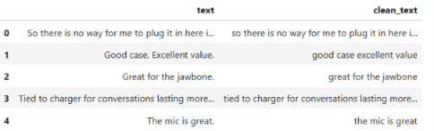
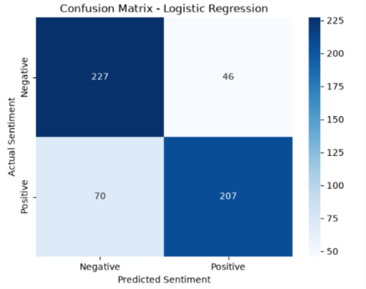

#### **Lab 01 - Sentiment Analysis Using Traditional Machine Learning**

**1.Dataset Loading and Text Preprocessing**

* Convert text to lowercase.
* Remove punctuation and unnecessary characters.
* Remove extra whitespace

**2.Exploring Positive and Negative Reviews**

1 = Positive review

0 = Negative review

* Positive reviews frequently contained words such as great, good, and best, while bad appeared frequently in negative reviews. 

**3.Splitting the Dataset**

80% training data -2198 reviews

20% testing data -550 reviews

**4. Bag of Words** 

* convert cleaned reviews into vectors of word counts.
* Each word becomes a column for each review, the vector records how many times each vocabulary word appears.
* BoW records word counts but does not save word order.

**5.Training Logistic Regression**

* Logistic Regression classifier on the BoW features to predict whether a review was positive or negative.

Accuracy (78.91%) : The model correctly classified 434 out of 550 test reviews.

Precision (81.82%): Of the reviews predicted to be positive, approximately 82% were actually positive.

Recall (74.73%)   : The model correctly identified approximately 75% of the actual positive reviews.

F1-score (78.11%) : This combined measure balances precision and recall.

* The model made useful sentiment predictions with a relatively simple traditional ML approach. However, its recall was lower than its precision, indicating that some genuine positive reviews were missed.

* Confusion Matrix - The model correctly predicted 227 negative and 207 positive reviews. It incorrectly predicted 46 negative reviews as positive, and 70 positive reviews as negative. In total, it made 116 incorrect predictions, explaining the 78.91% accuracy.

**6. Extension – Neural Network Using Word Embeddings**

* The initial neural network achieved 64.36% test accuracy. After introducing padding masking and early stopping, the improved model achieved 82.55%.

**Observations**

* The Logistic Regression model using Bag of Words achieved a test accuracy of 78.91%, while the improved neural network incorporating word embeddings achieved 82.55%. 
* While Logistic Regression relies on word frequency features, the neural network learns dense word representations that can capture useful relationships between words. 
* Logistic Regression offers a simpler and more computationally efficient approach. 
* Padding masking improved the neural network's performance, although signs of overfitting were observed.
* Both models have limitations in capturing word order and complex contextual relationships, highlighting the importance of text representation and model architecture in sentiment classification.

