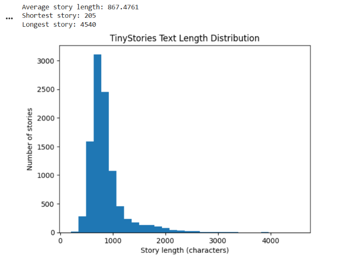
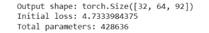

### **Lab 03 - Developing a Tiny Transformer Language Model 10/10/2026**

**1. Dataset Loading and Exploration**

* Loaded 10,000 stories from the TinyStories dataset.
* Displayed sample stories and examined their lengths.
* Average story length - 867.48 characters.

**2. Text Preprocessing**

* Used character level tokenization.
* Created encoding and decoding functions.
* 92 unique characters.
* Split the data into 80% training and 20% validation.

**3. Preparing Training Data**

* Created input and target sequences for next token prediction by shifting the target sequence one character forward.

&#x20;   

&#x20;   Context size: 64

&#x20;   Batch size: 32

**4. Building the Transformer Model**

|***Configuration***|***Value***|
|-|-|
|Embedding size|128|
|Attention heads|4|
|Transformer layers|2|
|Context size|64|
|Batch size|32|
|Dropout|0.1|
|Trainable parameters|428,636|
|Optimizer|AdamW|
|Learning rate|0.0003|
|Loss function|Cross entropy|
|Device|CUDA GPU|

**5. Model Training and Evaluation**

* Trained the model for 500 iterations using a CUDA GPU.

&#x20;        Validation loss: 2.1240

&#x20;        Perplexity: 8.3648

* Both training and validation losses decreased during training.

**6. Story Generation**

* Used "Once upon a time" as the starting prompt to generate a story.

* The model generated some recognizable English words, but the story was not grammatically correct or fully meaningful.

**7. Model Improvements**

***Additional Training***

* Trained the model for another 1,000 iterations to improve next character prediction.

|Metric|Validation|Perplexity|
|-|-|-|
|500 iterations|2.1240|8.3648|
|1500 iterations| 1.6421|5.1659|

* Additional training reduced validation loss and perplexity.

***Temperature Adjustment***

* Reduced the temperature to 0.7 to control randomness and improve text generation consistency.

***Increasing Transformer Layers***

* Increased the number of Transformer layers from two to three and trained the experimental model for 500 iterations.

|Metric|Parameters|Training Iterations|Validation Loss | Perplexity|
|-|-|-|-|-|
|2 Layers|428,636|500|2.1240| 8.3648|
|3 Layers| 626,908 |500|2.0921|8.1021 |

* The three layer model achieved slightly lower validation loss and perplexity. However, further experiments are required to confirm the improvement.

**8. Performance Improvement Mechanisms**

* Multi head attention: Learns contextual relationships.
* Causal masking: Prevents access to future tokens.
* Residual connections: Improve gradient flow.
* Layer normalization: Stabilizes training.
* Dropout: Reduces overfitting.
* AdamW: Supports efficient parameter updates.

**9. Saving the Model**

* Saved the trained model parameters, vocabulary and configuration for future story generation.

[Trained Model](results/tiny\_transformer\_model.pth)

**10. Gradio Interface**

* Developed a Gradio chat interface to generate stories using user provided prompts.

**To Improve Performance**

* Increase the training dataset size.
* Increase Transformer layers and embedding size.
* Increase context size to learn longer relationships.
* Increase training iterations.
* Improve dataset cleaning.
* Use subword tokenization instead of character level tokenization.

**Conclusion**

The Tiny Transformer successfully learned character level language patterns. Additional training and increasing Transformer layers improved next character prediction. However, more training data and computational resources are required to generate meaningful and coherent stories.

